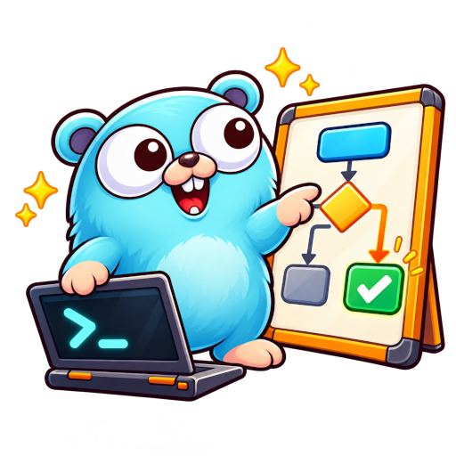

# Decide

<p align="center">
  
</p>

Jev's native decision API in a Go CLI and MCP server. Give coding agents typed decisions for classification, routing, verification, and rubric scoring, or use the same commands in shell workflows.

The command is `decide`. Inputs and answers keep Jev's native vocabulary and response format. Independent community project, not affiliated with TypeSafe AI.

## What it does

- `noul` checks a statement and returns a probability from 0 to 1.
- `choice` selects one label from your declared options; `score` grades against an ordered rubric.
- `box` locates a target in an image, with explicit experimental opt-in.
- `systemone` asks several independent questions about shared evidence in one native request.
- Offline request previews, caller-defined acceptance gates, and ordered JSONL batches with bounded concurrency.
- Provider connections, MCP tools, and a bundled CLI skill for coding agents.

## Install the CLI

Linux or macOS:

```sh
curl -fsSL https://raw.githubusercontent.com/koltyakov/decide/main/scripts/install.sh | sh
```

Windows, from PowerShell, CMD, or Bash:

```powershell
powershell.exe -NoProfile -c "irm https://raw.githubusercontent.com/koltyakov/decide/main/scripts/install.ps1|iex"
```

Installers require published [GitHub releases](https://github.com/koltyakov/decide/releases) and verify SHA-256 checksums. Unix installs to `~/.local/bin`; add it to `PATH` if needed. On Windows, open a new terminal to reload PATH. Set `DECIDE_VERSION` to pin a release or `DECIDE_INSTALL_DIR` to choose a directory.

Or install with Go 1.27.3 or newer:

```sh
go install github.com/koltyakov/decide/cmd/decide@latest
```

Add Go's bin directory to `PATH`. Installers do not configure credentials or agent integrations.

## Connect a provider

```sh
decide providers connect official
decide providers status
decide capabilities
```

`connect` uses an environment or saved key, or prompts for one. It verifies the connection before saving; failed verification leaves saved settings untouched. Keep keys out of command arguments and agent chat.

The official default is `jev-latest`. OpenRouter, AI/ML API, Vercel, DigitalOcean, Cloudflare, and custom native endpoints are also supported. Model versions and image support differ by provider; Clef is a separate model family. See [providers, keys, and model support](docs/providers.md).

Use `decide providers use PROVIDER` to change the saved default. `status` and `capabilities` inspect local configuration, not live availability. Official connection checks use model discovery; some other providers require a small billable decision.

## Install MCP and skills

Install either or both. MCP exposes tools; the skill teaches CLI usage. Both install globally by default.

```sh
decide install-mcp opencode
decide install-skill opencode
```

Replace `opencode` with `claude`, `codex`, `cursor`, `copilot`, `devin`, `windsurf`, `antigravity`, or `agents`. Add `--project .` for project-local installation, except legacy Windsurf MCP. Reload MCP in your host if needed.

Then ask your agent:

> Use Decide to classify these support tickets as billing, technical, or needs review.

MCP provides `noul`, `choice`, `score`, `box`, `systemone`, offline `capabilities`, and provider `models` discovery. Credentials stay outside agent configuration. For other MCP hosts, configure a stdio server running `/absolute/path/to/decide mcp`. See [client paths, discovery, and tool schemas](docs/agents.md).

To allow experimental images and Box, install MCP with `decide install-mcp opencode --experimental-images`. Tool calls cannot enable this permission or change the provider or endpoint.

## Run a decision

```sh
decide noul --instructions 'Does this message need attention today?' \
  --state 'The payment integration is down. Please fix it today.'

decide choice --instructions 'Which team should handle this?' \
  --state 'Please refund the duplicate charge.' \
  --criteria '{"billing":"Invoices, charges, refunds","technical":"Bugs and integrations","review":"Unclear"}'

decide score --instructions 'How severe is this incident?' \
  --state 'Checkout is unavailable for all customers.' \
  --criteria '["No service impact","Partial outage","Full outage"]'
```

`--state` is literal text. Use `--state-file PATH` for a file, `--state-file -` for stdin, and `--state-format json` for structured state. Instructions and criteria also have explicit file flags. Strings such as `@path` never trigger file reads.

Output is native JSON on stdout; JSON errors go to stderr. Add `--pretty` for readability or `--output value` to extract one answer. Noul returns a probability, not a boolean; Score is zero-based and may be fractional. See the [CLI skill](skills/decide/SKILL.md) for image inputs and more examples.

## Preview, gate, and batch requests

From a checkout:

```sh
decide systemone examples/triage.json --dry-run
decide systemone examples/triage.json --answer urgent --at-least 0.9
decide batch examples/triage.json --states examples/states.jsonl --jobs 4
```

`--dry-run` validates and previews the encoded request without a key or API call. Preview output includes supplied content, so keep it private. It requires JSON output and does not predict model accuracy or server acceptance.

Gates use only thresholds you supply. Exit `5` means a valid decision did not meet the gate, not an API failure. Probability and confidence are different; missing confidence fails a requested confidence gate. Multi-question gates and value output require `--answer NAME`.

Batch reuses the recipe's questions for each JSONL state, preserves input order, and reports record failures explicitly. Exit `6` means some records failed. See [workflow controls](docs/workflows.md) for policies, reusable requests, and batch limits.

## Build and test

Requires Go 1.27.3 or newer. No CGO dependency.

```sh
make build
make fmt-check
make lint
make check
```

`make build` produces `bin/decide`; `make install` installs only the CLI. Tests use local fake APIs, never live credentials. `make release-local` builds and verifies six platform bundles; `make ci` runs the full local CI checks. See `make help` and the [contributor guide](AGENTS.md).

## Documentation

- [CLI skill and scenarios](skills/decide/SKILL.md), [example payloads](examples).
- [Agent integrations and MCP](docs/agents.md), [providers and model support](docs/providers.md).
- [Workflow controls](docs/workflows.md), [architecture](docs/architecture.md), [design decisions](docs/design.md).
- [API references](docs/api-reference.md), [contributor guide](AGENTS.md).

## Limits and trust

Decision calls may be billed. Decide never automatically retries a request, downgrades a model, or switches providers. Endpoint overrides receive credentials, so use only trusted endpoints. HTTPS is required except on loopback, and redirects are disabled.

Images and Box are experimental and need explicit opt-in on a supporting provider. A Box has no not-found result; pair it with a presence question. Decide never acts on coordinates or treats a model answer as authorization for a downstream action.

## Licence

[MIT](LICENSE)
